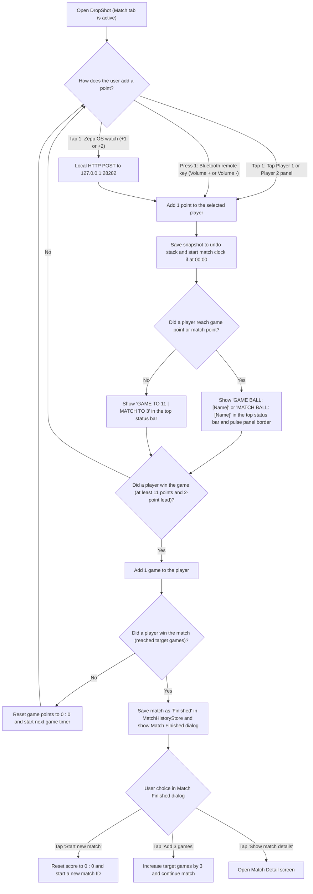
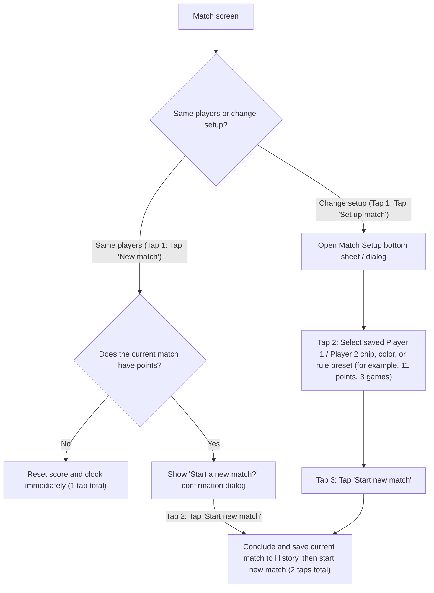
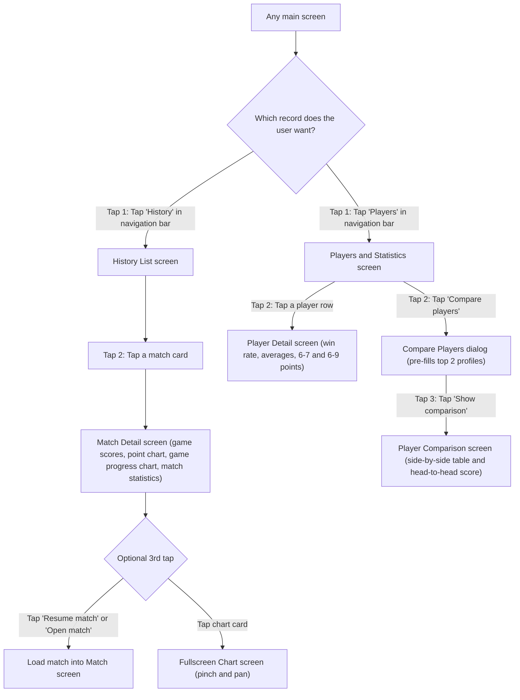
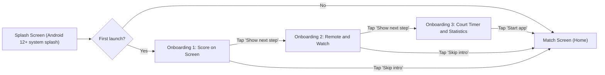

# Deliverable 1: Personas and User Flows

## 1. User Personas

### Persona 1: Marek (Club League Player)
- **Age:** 34 years old.
- **Occupation:** Civil engineer.
- **Technical skill:** Medium. He uses an Android phone and an Amazfit Active 2 smartwatch.
- **Context of use:** He plays squash 3 times each week on a glass-back court. He puts his phone on a shelf behind the court glass in landscape mode and wears his watch on the court.
- **Goals:**
  - Add points from his watch after each rally without walking to the door.
  - See the current game score and the point score from 6 m away through the glass wall.
  - Check the remaining time of his 60 min court booking so that the next players do not interrupt the last game.
- **Problems:**
  - Sweat on his hands makes small phone buttons difficult to tap between games.
  - Bright overhead court lights cause glare on low-contrast screens.
  - Accidental double taps on a watch can add an extra point if the app does not show clear visual feedback and an undo action.

### Persona 2: Anna (Recreational Player and Organizer)
- **Age:** 28 years old.
- **Occupation:** Financial analyst.
- **Technical skill:** High. She uses a Pixel phone in portrait mode before and after the match, and in landscape mode during the match.
- **Context of use:** She plays weekly matches with a group of 4 friends. They rotate partners and track their results over the season.
- **Goals:**
  - Select 2 saved player profiles and start a new match in less than 15 s.
  - Review the point-by-point chart and the longest point streak after the match.
  - Compare the win rate and the average points per match between 2 players.
- **Problems:**
  - Typing player names before each match takes too much court time.
  - When a friend changes a nickname, old scoreboard apps lose the historical statistics for that player.
  - She wants to use the app without creating an account first, and only sign in later if she buys a new phone.

### Persona 3: Tomasz (Senior Amateur Player and Referee)
- **Age:** 59 years old.
- **Occupation:** Retired teacher.
- **Technical skill:** Low. He uses a 10-inch Android tablet with the system font size set to 150% and uses a cheap Bluetooth media remote control clipped to his pocket.
- **Context of use:** He plays casual matches and also acts as the marker for amateur club evenings. He has presbyopia and does not wear reading glasses on the court.
- **Goals:**
  - Use the Volume Up and Volume Down buttons on his Bluetooth remote control to add points for Player 1 and Player 2.
  - Read all labels, dialogs, and buttons clearly without his reading glasses.
  - Resume an unfinished match if the court time ends before the match finishes.
- **Problems:**
  - Text smaller than 16 sp is unreadable for him without glasses.
  - Complex menus with hidden gestures confuse him when he needs to undo a mistake quickly.
  - Color-only indicators (for example, a red dot without text) are hard for him to understand under warm court lamps.

---

## 2. User Flows for the Main Tasks

### Task 1: Keep the Score of a Match (Scoreboard, Remote Control, Watch, and Court Timer)

**Maximum taps for the primary action:** **1 tap** on the screen, **1 button press** on the Bluetooth remote control, or **1 tap** on the Zepp OS watch to add a point.

**Secondary actions during Task 1 (all within 1 to 2 taps):**
- **Undo the last point (1 tap):** Tap **Undo point** in the top app bar (or press the Pause media key / `<<` on the watch). The app restores the previous score snapshot.
- **Pause or resume the match (1 tap):** Tap **Pause match** in the top app bar. The match clock stops and the pause banner appears. Tap **Resume match** to continue.
- **Start the court timer (1 tap):** Tap **Start court timer** in the top app bar. The app sets the start time to the current full hour and counts down (default 60 min). At 30 min, 15 min, and 5 min remaining, the screen border frame changes color, the button label updates with a text status (`OK`, `WARN`, `END`), and the device vibrates if enabled.

---

### Task 2: Set Up and Start a New Match (Players, Colors, and Rules)

**Tap budget:**
- **Quick reset with the same players and rules (2 taps):** Tap **New match** (tap 1) -> Tap **Start new match** in the confirmation dialog (tap 2).
- **Configured match with different players or rules (3 taps):** Tap **Set up match** on the Match screen (tap 1) -> Select Player 1, Player 2, or a rule chip in the Match Setup sheet (tap 2) -> Tap **Start new match** (tap 3).

---

### Task 3: Review Match History and Player Statistics

**Tap budget:**
- **Open a past match detail and its charts (2 taps):** Tap **History** in the navigation bar (tap 1) -> Tap a match card in the list (tap 2).
- **Resume an unfinished match from history (3 taps):** Tap **History** in the navigation bar (tap 1) -> Tap an unfinished match card (tap 2) -> Tap **Resume match** on the Match Detail screen (tap 3).
- **View a player profile or compare 2 players (2 to 3 taps):** Tap **Players** in the navigation bar (tap 1) -> Tap a player row to open Player Detail (tap 2), or tap **Compare players** (tap 2) and **Show comparison** (tap 3).

---

## 3. Onboarding Flow (Maximum 3 Screens)

The onboarding flow runs only on the first launch of the app. Every screen has a **Skip intro** button in the top app bar so the user can go straight to the Match screen in **1 tap**.

| Screen | Title | Purpose | Key Action |
|---|---|---|---|
| **Onboarding 1 of 3** | **Score every point on the court** | Explain how to add points by touching the two large panels and how to undo a point. | Tap **Show next step** (or **Skip intro**). |
| **Onboarding 2 of 3** | **Use a remote control or a watch** | Explain how a Bluetooth media remote control and the Zepp OS watch control the scoreboard without touching the phone. | Tap **Show next step** (or **Skip intro**). |
| **Onboarding 3 of 3** | **Track court time and statistics** | Set the default court rental duration (default `60 min`) and go to the Match screen. | Tap **Start app**. |

